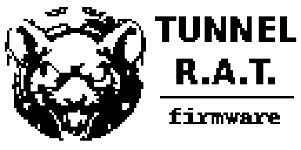

<!-- Device: Flipper Zero (Tunnel R.A.T. firmware) -->

# Tunnel R.A.T. Firmware for Flipper Zero

Custom Flipper Zero firmware from **cyberchuck01**, part of the Tunnel R.A.T. family
(NanoPi dashboard, field mice, T-Pager, PicoCalc remote…).

Built on **[Momentum](https://github.com/Next-Flip/Momentum-Firmware)**, so it carries the
official firmware's tools, the **Unleashed** (DarkFlippers) Sub-GHz extras, Momentum's
app pack and the **RGB backlight mod** support — with a different front end.

## What's different

- **Bruce-style main menu, no double layer.** The main menu is a carousel of big
  category icons: Sub-GHz · NFC · RFID · Infrared · iButton · BadUSB · Bluetooth ·
  GPIO / WiFi · Tunnel R.A.T. · Games · Media · Tools · More · Settings.
  Pick one and you get **one list** with the built-in app *and* every extra app for
  that category. Sub-folders (e.g. `GPIO/ESP`, `GPIO/FlipperHTTP`) open in place.
  No more *Apps → folder → app*. "More" collects any folders you add yourself.
- **Tunnel R.A.T. menu style** (default): one 2× icon in the middle, neighbours on
  each side, battery in the corner. The other Momentum styles are still under
  Momentum settings → Interface → Main menu.
- **Tunnel R.A.T. splash** after flashing and a **home-screen idle animation** with the
  rat logo.
- **Tunnel R.A.T. Link app** (`Tunnel R.A.T.` category): runs the Flipper CLI over the
  GPIO UART (pins 13/14) so an ESP32 bridge can put it on WiFi.

## Tunnel R.A.T. dashboard (NanoPi) — FLIPPER tab

Needs `dashboard-v16.py` + matching `tunnel-rat-install.py`.

| Link | How |
|---|---|
| USB | Plug the Flipper into the NanoPi hub. The installer's udev rule gives `/dev/flipper`. Nothing to run on the Flipper. |
| WiFi | Flash `tunnel_rat/TunnelRAT_FlipperBridge/TunnelRAT_FlipperBridge.ino` to the WiFi Dev Board (or any ESP32 on pins 13/14/GND), set the AP password + API key. On the Flipper open **Tunnel R.A.T. → Tunnel R.A.T. Link** and press OK. The bridge announces itself to the dashboard and serves the CLI on TCP 2323. |

From the tab: device / power / SD info, timed Sub-GHz RX, 125 kHz RFID, iButton and IR
captures (saved to FILES → flipper), IR universal remotes, SD browser with pull-to-FILES,
app launcher, and a shell.

## Building

Every push builds on GitHub Actions (`.github/workflows/build.yml`) — download the
`flipper-z-f7-update-*.tgz` artifact and install it with qFlipper or the Flipper app
(*Install from file*). Local build: `./fbt updater_package`.

## Credits & license

GPL-3.0, same as upstream. All credit for the base goes to the
[Momentum](https://github.com/Next-Flip/Momentum-Firmware),
[Unleashed](https://github.com/DarkFlippers/unleashed-firmware) and
[official Flipper](https://github.com/flipperdevices/flipperzero-firmware) teams and the app
authors in Momentum-Apps. The original Momentum readme is in `tunnel_rat/Momentum-ReadMe.md`.

Use it on gear you own or have permission to test. Sub-GHz transmit rules depend on where you live.
